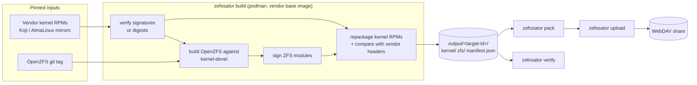
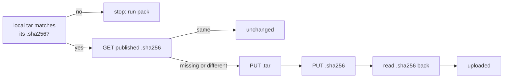
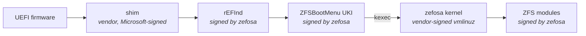

# Zefosator

**Vendor kernels with OpenZFS built in, for root-on-ZFS Fedora and AlmaLinux systems, with an
optional Secure Boot chain that needs no GRUB.**

Zefosator takes the vendor's binary kernel RPMs, builds OpenZFS against the matching
`kernel-devel`, and repackages the vendor RPMs with the ZFS modules inside. The result installs,
updates and boots like the stock kernel, with ZFS support that is always present and always
matches the kernel.

```console
$ rpm -q kernel-core zfs
kernel-core-7.2.9-201.zefosa.fc44.x86_64
zfs-2.4.4-0.fc44.x86_64
$ uname -r
7.2.9-201.fc44.x86_64
```

## Contents

- [Goals](#goals)
- [Scope](#scope)
- [How it works](#how-it-works)
- [Quick start](#quick-start)
- [Commands](#commands)
- [Configuration](#configuration)
- [Versions and releases](#versions-and-releases)
- [Archives and publishing](#archives-and-publishing)
- [Installing zefosa kernels](#installing-zefosa-kernels)
- [Secure Boot](#secure-boot)
- [Reproducible builds](#reproducible-builds)
- [Limitations](#limitations)
- [Development](#development)

## Goals

- **The kernel and ZFS never drift apart.** With DKMS or kABI-tracking kmods, a kernel update can
  arrive before a matching ZFS module, and a root-on-ZFS machine then fails to boot. Here the ZFS
  modules ship inside the kernel package, so `dnf upgrade` installs both together or neither.
- **The vendor kernel, unchanged.** The kernel is not recompiled. Vendor binaries, signatures and
  `uname -r` stay as the vendor built them, so vendor Secure Boot signatures and vendor support
  still apply.
- **Every change is checked.** Each rebuilt package is compared with the vendor's header. File
  digests, modes, owners, flags, scriptlets and dependencies must match apart from the intended
  changes, or the build fails.
- **Builds can be repeated.** The same inputs in the same build image give byte-identical RPMs
  and archives.
- **Secure Boot without GRUB.** A signed boot chain of shim, rEFInd and ZFSBootMenu, under a CA
  that you own.

## Scope

| Supported | Not supported |
|---|---|
| Fedora (kernels from Koji) and AlmaLinux 9 and 10 (kernels from the official mirrors) | Building kernels from source or patching the kernel |
| `x86_64`. Vendor files can describe other architectures. | Signing RPMs or repositories (do this when you publish) |
| Kernel packages with the ZFS modules added, plus the OpenZFS userspace packages | DKMS or kmod workflows: the zefosa kernel conflicts with `zfs-dkms` |
| Shim, rEFInd and ZFSBootMenu packages for UEFI Secure Boot | Managing dnf repositories. Zefosator produces archives; serving them as a repository is up to you. |

### What changes in a repackaged kernel

Compared with the vendor's packages, the only differences are:

| Package | Change |
|---|---|
| all | Release `<release>.zefosa.<dist>`, e.g. `201.fc44` becomes `201.zefosa.fc44`. A changelog entry and `Packager: Zefosa`. |
| `kernel-modules-core` | Adds the ZFS kernel modules (signed with your key) and `Provides: zfs-kmod = <version>` |
| `kernel-core` | `Requires: zfs-dracut >= <version>`, so every initramfs built when the kernel is installed contains the ZFS dracut module. `Conflicts: zfs-dkms`. |

`uname -r` keeps the vendor's value, because it is compiled into the kernel image and modules.
Only the RPM release carries the `.zefosa` tag.

## How it works



Each target is built in its own podman container from the vendor's base image (Fedora or
AlmaLinux), so the host needs no build toolchain. Downloads and OpenZFS checkouts are cached in
`cache/`.

## Quick start

**Requirements:** `podman` (rootless works) and [`uv`](https://docs.astral.sh/uv/)
(`dnf install podman uv`). Everything else runs inside containers. The Secure Boot QEMU test has
extra requirements, listed under [Testing in QEMU](#testing-in-qemu).

```sh
# 0. Once: a CA and a signing key, stored outside the project tree
uv run zefosator keys ca   --out ~/secure/zefosa-ca               # prompts for a passphrase
uv run zefosator keys leaf --ca ~/secure/zefosa-ca --out ~/secure/zefosa-signing

# 1. Inspect what a target resolves to
uv run zefosator plan targets/fedora-44-x86_64.yaml

# 2. Build: OpenZFS and the repackaged kernel, into output/fedora-44-x86_64/
uv run zefosator build targets/fedora-44-x86_64.yaml \
    --signing-key ~/secure/zefosa-signing/signing.key \
    --signing-cert ~/secure/zefosa-signing/signing.pem

# 3. Install the result in a clean container and check it
uv run zefosator verify targets/fedora-44-x86_64.yaml

# 4. Pack the archives and publish the ones that changed
uv run zefosator pack   targets/fedora-44-x86_64.yaml
uv run zefosator upload targets/fedora-44-x86_64.yaml
```

For a development build without keys, use `build --unsigned`: the ZFS modules are then unsigned
and will not load under Secure Boot.

## Commands

Every command except `keys` takes a target file as its first argument.

| Command | What it does |
|---|---|
| `plan TARGET` | Prints the resolved build plan as JSON, with every templated value filled in |
| `build TARGET` | Builds OpenZFS and the repackaged kernel into `output/<target-id>/` |
| `verify TARGET` | Installs the build output in a clean vendor container and checks it |
| `pack TARGET [ARCHIVE...]` | Packs built RPMs into the tar + sha256 archives the target lists |
| `upload TARGET [ARCHIVE...]` | Publishes archives whose published checksum differs from the local one |
| `build-boot TARGET` | Builds the Secure Boot packages (shim, and on Fedora also rEFInd, ZFSBootMenu, CA, tools) |
| `boottest TARGET` | Boots the built packages through the Secure Boot chain in QEMU |
| `keys ca` / `keys leaf` | Creates the Secure Boot CA, or issues a signing key from it |

Every target command accepts `--buildid ID`, which overrides the kernel release tag (see
[Versions and releases](#versions-and-releases)). Errors are printed as one line to stderr, and
the exit status is 1.

### `plan`

```console
$ uv run zefosator plan targets/fedora-44-x86_64.yaml
{
  "target_id": "fedora-44-x86_64",
  "kernel_version": "7.2.9",
  "upstream_release": "201.fc44",
  "uname_r": "7.2.9-201.fc44.x86_64",
  "zefosa_release": "201.zefosa.fc44",
  "zfs": {"tag": "zfs-2.4.4", "version": "2.4.4", "release": 0, ...},
  "packages": [{"name": "kernel", "url": "https://kojipkgs.fedoraproject.org/...", ...}, ...],
  "archives": [{"name": "fedora44-x86_64-zfs-userspace-packages", "files": [...]}, ...],
  ...
}
```

`plan` reads only the configuration and changes nothing. Run it after editing a target to see the
exact download URLs, releases and archive contents.

### `build`

```
zefosator build TARGET (--signing-key KEY --signing-cert CERT | --unsigned) [--buildid ID]
```

The signing key may instead come from the environment: `ZEFOSA_SIGNING_KEY` holds the key's PEM
text and `ZEFOSA_SIGNING_CERT` the certificate path. This suits CI secrets. The key must be stored
outside the project tree, which build containers mount, and it reaches the container only as a
podman secret.

The build:

1. downloads the vendor kernel RPMs, verifying AlmaLinux packages by GPG signature and Fedora
   Koji packages (which are unsigned) by digest;
2. clones OpenZFS at `zfs.tag`, applies `cherry_picks` and `patches`, and builds the userspace
   and kmod RPMs against `kernel-devel`;
3. signs the ZFS modules and repackages each vendor RPM;
4. compares every rebuilt header with the vendor's, and fails on any unexpected difference.

```
output/fedora-44-x86_64/
├── kernel/          repackaged kernel RPMs (kernel, kernel-core, kernel-modules-core, ...)
├── zfs/             all OpenZFS RPMs: userspace, dracut, devel, debuginfo, test, SRPMs
│                    (except kmod-zfs, whose modules went into the kernel)
└── manifest.json    input URLs and checksums, the OpenZFS commit, and the NEVRA and sha256
                     of every output
```

Logs of the last build are in `cache/build/<target-id>/logs/`.

### `verify`

Copies the output into a container of the vendor's plain base image and adds it as a local
repository with `priority=10`. It then checks that:

- dnf prefers the zefosa kernel even over a newer vendor kernel;
- `dnf install kernel zfs` pulls in `zfs-dracut`;
- `modinfo` finds the ZFS module;
- a `dracut --no-hostonly` initramfs contains ZFS;
- `rpm -V` passes.

### `pack` and `upload`

```
zefosator pack   TARGET [ARCHIVE...]
zefosator upload TARGET [ARCHIVE...] [--dry-run] [--force] [--upload-key-file FILE]
```

Both commands act on every archive the target defines unless you name some. See
[Archives and publishing](#archives-and-publishing).

### `build-boot`, `boottest`, `keys`

See [Secure Boot](#secure-boot).

## Configuration

```
common.yaml                     settings shared by every target: boot package pins, upload URL
targets/<target>.yaml           one kernel + one OpenZFS version (+ boot inputs, archives)
vendors/<vendor>.yaml           where a distro's packages come from and how to build there
patches/                        optional OpenZFS patches referenced by targets
```

### Target file

A target pins exactly one kernel and one OpenZFS version. A version bump means editing a few
lines here:

```yaml
# targets/almalinux-9-x86_64.yaml
vendor: almalinux             # -> vendors/almalinux.yaml
os_version: "9.8"             # quote it: YAML reads 9.10 as 9.1
arch: x86_64
kernel:
  version: 5.14.0
  release: 687.52.1
zfs:
  tag: zfs-2.3.9              # git tag (or commit) to build
  version: 2.3.9
  # release: 0                # default; see "Versions and releases"
  # repo: https://github.com/openzfs/zfs.git
  # cherry_picks: []          # commits to cherry-pick onto the tag
  # patches: []               # files under patches/, applied with `git apply`
# buildid: zefosa             # default: derived from zfs.release
boot:                         # inputs for build-boot and boottest
  shim: {version: "16.1", release: "7.el9.alma.1"}
  cloud_image: https://repo.almalinux.org/almalinux/9/cloud/x86_64/images/AlmaLinux-9-GenericCloud-latest.x86_64.qcow2
archives:                     # see "Archives and publishing"
  almalinux9-x86_64-zfs-userspace-packages:
    - "{{ target_id }}/zfs/zfs-{{ zfs.version }}-{{ zfs.release }}.el{{ os_major }}.{{ arch }}.rpm"
    # ...
```

The target ID, which names the output directory, is `<vendor>-<os_version>-<arch>`, e.g.
`almalinux-9.8-x86_64`.

### Vendor file

A vendor file describes a distribution: the build image, where its kernel packages are
downloaded from, and which package plays which role. Values can vary by version or architecture.

```yaml
defaults:
  image:
    base: "docker.io/almalinux/{{ os_major }}-base"
    setup_packages: [epel-release]
    enable_repos: [crb, epel]
    packages: [autoconf, automake, gcc, rpm-build, ...]
  dist_tag: "el{{ os_major }}_{{ os_minor }}"
  gpg_keys: ["/etc/pki/rpm-gpg/RPM-GPG-KEY-AlmaLinux-{{ os_major }}"]
  kernel_url: "https://{{ 'raw.' if os_major == 9 }}repo.almalinux.org/almalinux/{{ os_version }}/{{ repo }}/{{ arch }}/os/Packages/{{ file }}"
  packages:
    - {name: kernel, repo: BaseOS}                              # first entry: the main package
    - {name: kernel-core, repo: BaseOS, role: core}             # gets the zfs-dracut / zfs-dkms deps
    - {name: kernel-modules-core, repo: BaseOS, role: modules}  # gets the ZFS modules
    - {name: kernel-devel, repo: AppStream, role: devel}        # OpenZFS is built against it
    - {name: kernel-abi-stablelists, repo: BaseOS, arch: noarch}
  boot:
    common: false             # true on the one vendor that builds the distro-independent boot packages
    esp_dir: almalinux
    shim_url: "..."
    drop_requires: ['^grub2-', 'grub2-sig-key']
overrides:
  - when: {os_version: ">=10", arch: aarch64}
    set: {packages: [...]}
```

- The roles `core`, `modules` and `devel` must each appear exactly once. Every listed package is
  rebuilt.
- `overrides` apply in order, each one when all of its `when` keys match. `os_version` is a
  version range. Mappings merge key by key and lists are replaced. Use inline `{{ ... if ... }}`
  for small string differences and `overrides` for structural ones. When a distribution changes
  fundamentally, copy the vendor file and point the target at the new name.

### `common.yaml`

```yaml
boot:                         # pinned inputs of the distro-independent boot packages
  zfsbootmenu: {version: "3.1.0", tag: v3.1.0, release: 1, ...}
  refind:
    version: "0.14.2"
    upstream_release: "5.fc44"          # Fedora's release of rEFInd-unsigned-x64
    release: 1                          # zefosa-refind package release
    url: "https://kojipkgs.fedoraproject.org/packages/rEFInd/{{ boot.refind.version }}/..."
    sha256: b00339df...
  ca:    {version: "1", release: 1}
  tools: {version: "1.0", release: 1}
upload:
  webdav_url: https://cloud.example.org/public.php/webdav/
```

### Templating

String values in every configuration file are Jinja2 templates. Rendering is sandboxed, and an
undefined variable is an error. Quote any value that starts with `{{`.

| Where | Variables |
|---|---|
| target and vendor files | `vendor`, `os_version`, `os_major`, `os_minor` (integers), `arch`, `buildid`, `kernel.*`, `zfs.*`, `dist`, `upstream_release`, `uname_r`, `zefosa_release`, `target_id`. In `kernel_url` also `name`, `repo`, `pkg_arch` and `file`. |
| `archives` paths | every field `zefosator plan` prints, plus `boot_packages` (the `boot` section of `common.yaml`) |
| `common.yaml` | the file's own values, e.g. `{{ boot.refind.version }}` |

## Versions and releases

```
kernel RPMs:   <kernel.version>-<kernel.release>.<buildid>.<dist>     7.2.9-201.zefosa.fc44
OpenZFS RPMs:  <zfs.version>-<zfs.release>.<dist>                     2.4.4-0.fc44
```

| `zfs.release` | buildid (derived) | Kernel release | Use |
|---|---|---|---|
| `0` (default) | `zefosa` | `201.zefosa.fc44` | Normal builds. An OpenZFS update ships with the next kernel. |
| `1`, `2`, ... | `zefosa1`, `zefosa2`, ... | `201.zefosa1.fc44` | Rebuilding the same kernel, e.g. for an urgent OpenZFS fix |

RPM sorts these as `201.fc44 < 201.zefosa.fc44 < 201.zefosa1.fc44 < 202.fc44`. An emergency
rebuild therefore upgrades over the regular build of the same kernel, and the next kernel
(`202.zefosa.fc44`) upgrades over both. `--buildid` or `buildid:` in the target overrides the derived value.

## Archives and publishing

Each target lists the RPMs to publish, grouped into tar archives. Package paths are relative to
`output/` and templated, so a version bump needs no edits here:

```yaml
archives:
  fedora44-x86_64-zfs-userspace-packages:        # archive name: output file base, and the CLI argument
    - "{{ target_id }}/zfs/zfs-{{ zfs.version }}-{{ zfs.release }}.fc{{ os_major }}.{{ arch }}.rpm"
    - "{{ target_id }}/zfs/zfs-dracut-{{ zfs.version }}-{{ zfs.release }}.fc{{ os_major }}.noarch.rpm"
  fedora44-x86_64-zfs-kernel-packages:
    - "{{ target_id }}/kernel/kernel-core-{{ kernel_version }}-{{ zefosa_release }}.{{ arch }}.rpm"
    - "boot/zefosa-boot-{{ boot_packages.tools.version }}-{{ boot_packages.tools.release }}.noarch.rpm"
```

### Packing

```console
$ uv run zefosator pack targets/fedora-44-x86_64.yaml
output/fedora-44-x86_64/archives/fedora44-x86_64-zfs-userspace-packages.tar (3246080 bytes) sha256 ca37f21d...
output/fedora-44-x86_64/archives/fedora44-x86_64-zfs-kernel-packages.tar (215275520 bytes) sha256 67497a5b...
```

- Each archive becomes `<name>.tar` plus `<name>.sha256`, which `sha256sum -c` can check.
- The RPMs are stored side by side, without directories, owned by root with mode 0644 and dated by
  each RPM's build time. The same RPMs therefore always give the same archive.
- Each file must be listed, with a matching checksum, in the `manifest.json` of the build that
  produced it. If any file is missing or stale, `pack` lists every problem and writes nothing.
- A failed or interrupted run never leaves a `.sha256` that does not match its tar.

### Uploading

```console
$ uv run zefosator upload targets/fedora-44-x86_64.yaml
Upload key:
fedora44-x86_64-zfs-userspace-packages: unchanged (3246080 bytes, sha256 ca37f21d...)
fedora44-x86_64-zfs-kernel-packages: uploaded (215275520 bytes, sha256 67497a5b...)
```



- Archives go to `upload.webdav_url` in `common.yaml`, a Nextcloud public share whose token
  serves as the upload key. The share must allow reading but need not allow listing.
- Because builds are reproducible, an OpenZFS archive is usually `unchanged` after a kernel bump
  and is not uploaded again. The checksum is uploaded last, so an interrupted upload is redone on
  the next run.
- `--dry-run` only reads the published checksums and reports `would upload`. `--force` uploads
  even unchanged archives.
- **The upload key** comes from the first available source:

  | Source | Notes |
  |---|---|
  | `--upload-key-file FILE` | Mode 0600, stored outside the project tree |
  | `ZEFOSA_UPLOAD_KEY` | Suits CI. Set it interactively with `read -s ZEFOSA_UPLOAD_KEY; export ZEFOSA_UPLOAD_KEY`. |
  | prompt | Only when stdin is a terminal |

  The key never appears on a command line or in output. It is sent only over https, and
  redirects are refused so that it cannot be forwarded to another host.
- Network errors and 5xx responses are retried with backoff. A rejected key fails at once.

## Installing zefosa kernels

Serve the packages from a dnf repository whose `priority` is lower (stronger) than the vendor
repositories, which default to 99:

```ini
# /etc/yum.repos.d/zefosa.repo (example)
[zefosa]
name=Zefosa kernels with OpenZFS
baseurl=https://repo.example.org/zefosa/fedora/$releasever/$basearch/
enabled=1
priority=10
gpgcheck=1                    # needs signed packages, see Limitations
gpgkey=https://repo.example.org/zefosa/RPM-GPG-KEY-zefosa
```

dnf then takes `kernel`, `kernel-core` and the rest from the zefosa repository, even when a vendor
repository has a newer version. `dnf upgrade` installs only zefosa kernels, and a new vendor
kernel is held back until zefosa has built it. Vendor kernels still appear in `dnf list`, but
dnf never chooses them. Disabling the repository returns the machine to vendor kernels.

```sh
dnf install kernel zfs        # pulls zfs-dracut; the initramfs gets the ZFS module
```

## Secure Boot

Zefosa machines can boot with UEFI Secure Boot enabled and without GRUB:



- Vendor-signed binaries (shim, `vmlinuz`, vendor modules) are never re-signed. Zefosa signs only
  what it builds: the ZFS modules, rEFInd and the ZFSBootMenu images.
- Each machine enrolls the zefosa CA once, as a MOK key. The kernel then trusts it for modules
  (the `.machine` keyring), and shim trusts it for rEFInd and ZFSBootMenu.
- ZFSBootMenu runs the zefosa Fedora kernel, which is locked down under Secure Boot. It loads only
  signed modules, and it kexecs only kernels whose signatures verify against the vendor CA that
  shim provides.

### Keys

```sh
uv run zefosator keys ca   --out ~/secure/zefosa-ca          # writes ca.key (encrypted), ca.pem, ca.der
uv run zefosator keys leaf --ca ~/secure/zefosa-ca --out ~/secure/zefosa-signing
                                                             # writes signing.key, signing.pem, signing.der
```

| Key | Protection | Lifetime | Where it lives |
|---|---|---|---|
| CA (`ca.key`) | Passphrase of at least 12 characters. Stored as PKCS#8 with AES-256-CBC and PBKDF2-HMAC-SHA256 at 600,000 iterations. | 20 years by default (`--days`). It is enrolled on every machine. | Offline. A password manager can hold the file and its passphrase together. |
| Leaf (`signing.key`) | Unencrypted, because builds use it unattended | At most 3 years. Issuing a new leaf needs no action on machines. | The build machine, or a CI secret |

The CA certificate can sign only certificates (`keyCertSign`, not `digitalSignature`), because
only such MOK keys reach the kernel's `.machine` keyring. Leaves are code-signing certificates.
Keep both keys **outside** the project tree.

### Building the boot packages

```sh
# Fedora target: shim plus the distro-independent packages (needs the CA certificate)
uv run zefosator build-boot targets/fedora-44-x86_64.yaml \
    --signing-key ~/secure/zefosa-signing/signing.key \
    --signing-cert ~/secure/zefosa-signing/signing.pem \
    --ca-cert ~/secure/zefosa-ca/ca.pem

# AlmaLinux targets: shim only, no key needed
uv run zefosator build-boot targets/almalinux-9-x86_64.yaml
```

| Package | Output | Contents |
|---|---|---|
| `shim-x64-*.zefosa` | `output/<target-id>/boot/` | The vendor shim with byte-identical EFI binaries, installed in `\EFI\zefosa\`, without the GRUB requirements |
| `zefosa-secureboot-ca` | `output/boot/` | `/usr/share/zefosa/keys/zefosa-ca.{der,pem,sha256}` |
| `zefosa-refind` | `output/boot/` | Fedora's rEFInd (pinned in `common.yaml`), signed, installed as `\EFI\zefosa\grubx64.efi` |
| `zefosa-zfsbootmenu` | `output/boot/` | Signed ZFSBootMenu UKI |
| `zefosa-zfsbootmenu-recovery` | `output/boot/` | The same UKI with rescue tools: `efibootmgr`, `mokutil`, `gdisk`, `cryptsetup`, `ssh`, `rsync`, ... |
| `zefosa-boot` | `output/boot/` | The `zefosa-boot` command, `zbm-kcl` and the `20-zbm.install` kernel-install plugin. Replaces GRUB. |

The inputs are pinned in the `boot` section of `common.yaml`. The build refuses a rEFInd download
whose checksum or version does not match the pins. After a zefosa Fedora kernel update or a
ZFSBootMenu update, bump `boot.zfsbootmenu.release` and rebuild the ZFSBootMenu images.

### Testing in QEMU

```sh
uv run zefosator boottest targets/fedora-44-x86_64.yaml --ca-cert ~/secure/zefosa-ca/ca.pem
```

A builder VM installs a root-on-ZFS system from the target's `cloud_image`, with the built kernel
and boot packages. The system then boots under OVMF with Secure Boot enabled and the CA
pre-enrolled as a MOK key. The test checks:

- Secure Boot is on, and kernel lockdown is `integrity`;
- the root filesystem is ZFS;
- the `zfs` module is signed by the CA, and the CA is in the `.machine` keyring;
- ZFSBootMenu refuses an unsigned kernel, and shim refuses an unsigned ZFSBootMenu image.

The test needs `qemu-system-x86-core`, `qemu-img`, `guestfs-tools`, `libguestfs`,
`python3-virt-firmware`, `sbsigntools` and `edk2-ovmf`.

### Setting up a machine

```sh
dnf install zefosa-boot     # replaces shim-x64 and grub2-efi-x64
zefosa-boot setup           # writes refind.conf, adds the firmware boot entry, requests CA enrollment
reboot                      # MokManager: Enroll MOK -> Continue -> Yes -> enter the root password
zefosa-boot status          # shows the state of the boot chain
```

| Command | Purpose |
|---|---|
| `zefosa-boot setup [--pool POOL] [--esp DIR] [--no-firmware] [--no-mok]` | Writes `\EFI\zefosa\refind.conf` with `zbm.prefer=<pool>`, adds a firmware entry for `\EFI\zefosa\shimx64.efi` and requests MOK enrollment of the CA |
| `zefosa-boot status` | Shows the Secure Boot state, CA enrollment, the firmware boot entry, the ESP files, the preferred pool and the installed packages. Warns if the kernel-install layout is not the one ZFSBootMenu expects. |
| `zefosa-boot cmdline [-a ARG] [-r ARG] [-e] [-d] [BE]` | Shows or changes the kernel command line of a boot environment (`org.zfsbootmenu:commandline`, like `zbm-kcl`) |

- `refind.conf` holds the ZFSBootMenu options (the preferred pool, the timeout and the recovery
  entry). Package updates never overwrite it.
- The firmware entry passes no load options, so it works even on firmware that drops them.
- On AlmaLinux, dnf 4 treats replacing the protected `grub2-efi-x64` as removing it and refuses.
  Install with `dnf install --setopt=protected_packages= zefosa-boot` instead. Fedora's dnf 5 needs
  no extra option.

## Reproducible builds

Building the same inputs in the same build image gives byte-identical binary RPMs, so the
archives are byte-identical too. A kernel bump that leaves OpenZFS unchanged therefore leaves the
OpenZFS packages, their archive and its published checksum unchanged.

- Build times and file timestamps come from `SOURCE_DATE_EPOCH`, and the build host is recorded
  as `zefosa`. For OpenZFS the epoch is the commit time of `zfs.tag`. For the kernel it is the
  newest of that time, the vendor RPMs' build times and their file times. `manifest.json` records
  both epochs (`source_date_epochs`).
- OpenZFS is built in a fixed directory, so ELF build IDs and debug info do not change between
  builds.
- The build image is an input too: a newer image, with newer compilers or libraries, gives
  different RPMs.
- Source RPMs and the `build-boot` packages are not reproducible yet.

To see what differs between two builds, run
`tools/compare-rpms.py DIR_A DIR_B [SUBSTRING...]`. It needs the system `python3-rpm` and reports
the differing header tags, file attributes and ELF sections.

## Limitations

- **Repackaged RPMs are unsigned.** AlmaLinux RPM signatures and IMA file signatures cannot be
  carried over. Sign the packages or the repository when you publish them.
- **Unsupported RPM features fail the build.** Scriptlet triggers and file triggers are not
  supported. A vendor package that uses an unknown header tag stops the build rather than being
  repackaged incompletely.
- **OpenZFS updates wait for a kernel.** With the default release scheme, a new OpenZFS ships
  with the next kernel build, or sooner through an emergency rebuild (`zfs.release: 1`).

## Development

```sh
uv run zefosator-check                          # ruff format --check, ruff check, mypy --strict, pytest
uv run pytest -m container                      # repackage every real package of every target
                                                # (needs rpmbuild and the RPMs in cache/downloads/)
uv run python -m tests.fixtures.make_fixtures   # regenerate header fixtures from cache/downloads/
```

The tests use a frozen fixture project in `tests/fixtures/project/`, so version bumps in
`targets/` never break them. All code is fully type-annotated, and `mypy --strict` and `ruff`
with `select = ["ALL"]` must pass.
